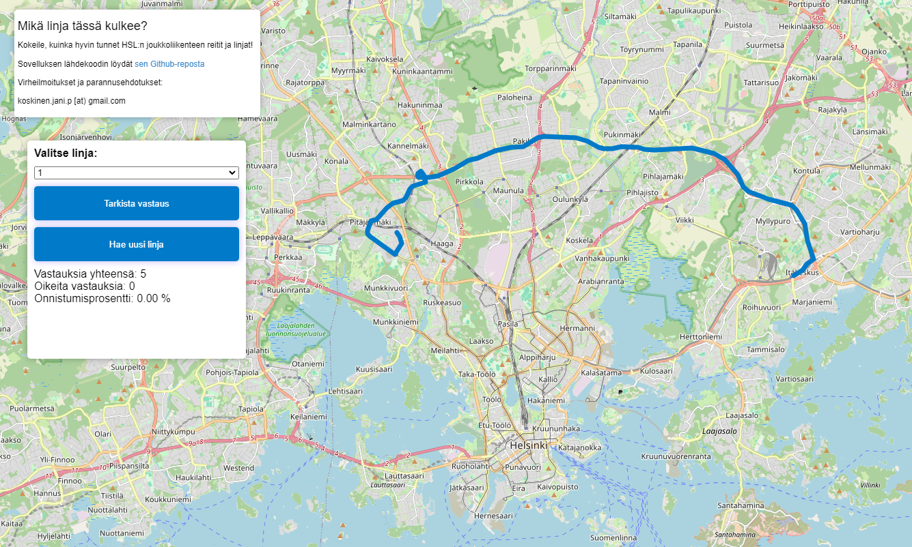

# Mikä reitti?

Flask-pohjainen selainsovellus, jolla voit testata HSL:n joukkoliikenteen tietämystäsi arvaamalla kartalla kulkevien linjojen tunnuksia.

## Ominaisuudet

- Kahden pelaajan kutsulinkillä toimiva peli
- Sama reittisarja molemmille pelaajille ja synkronoidut kierrokset
- Valittava reittimäärä sekä bussi-, metro-, ratikka- ja junasuodattimet
- Kierroskohtaiset tulokset, pisteet ja välitön uusintaottelu
- Puhelimen pystynäytölle optimoitu käyttöliittymä
- Yksinpeliharjoittelu

## Käynnistys paikallisesti

```powershell
python -m venv .venv
.venv\Scripts\pip install -r requirements.txt
$env:SECRET_KEY = "vaihda-tama-salaiseksi-avaimeksi"
.venv\Scripts\flask --app app run
```

Paikallinen kehityspalvelin käyttää oletuksena prosessin sisäistä pelivarastoa. App Enginessä moninpelit tallennetaan Firestoren `games`-kokoelmaan ja Flaskin allekirjoitusavain luetaan Secret Managerista.

## Reittidatan päivittäminen

Päivitä sovelluksen linjageometriat lataamalla HSL:n uusin GTFS-paketti projektin juuresta:

```powershell
.venv\Scripts\python.exe get_data.py
```

Komento validoi GTFS-tiedostot, yhdistää linjoihin niiden HSL-vyöhykkeet pysäkki- ja aikataulutiedoista ja korvaa `data\processed\lines.pkl`-tiedoston vasta, kun uusi aineisto on käsitelty onnistuneesti. Aiemmin ladattua ZIP-tiedostoa tai purettua GTFS-hakemistoa voi käyttää ilman verkkolatausta:

```powershell
.venv\Scripts\python.exe get_data.py --input data\hsl\hsl.zip
.venv\Scripts\python.exe get_data.py --input data\hsl
```

Kaikki komentorivivalinnat näkee komennolla:

```powershell
.venv\Scripts\python.exe get_data.py --help
```

## Google Cloud -valmistelu

Valitse ensin oikea projekti ja ota palvelut käyttöön:

```powershell
gcloud config set project YOUR_PROJECT_ID
gcloud services enable appengine.googleapis.com firestore.googleapis.com secretmanager.googleapis.com cloudbuild.googleapis.com artifactregistry.googleapis.com
```

Luo Firestore Native -tietokanta Google Cloud Consolessa tai komentoriviltä, jos projektissa ei vielä ole `(default)`-tietokantaa. Valitse tietokannalle samaa maantieteellistä aluetta vastaava sijainti kuin App Enginelle.

```powershell
gcloud firestore databases list
gcloud firestore databases create --database="(default)" --location=eur3 --type=firestore-native
```

Sovellus odottaa Secret Managerista salaisuutta nimeltä `flask-secret-key`, versiona `1`. App Enginen käyttämälle palvelutilille pitää antaa Secret Manager Secret Accessor- ja Cloud Datastore User -roolit:

```powershell
$projectId = gcloud config get-value project
$appServiceAccount = "${projectId}@appspot.gserviceaccount.com"
gcloud secrets add-iam-policy-binding flask-secret-key --member="serviceAccount:$appServiceAccount" --role="roles/secretmanager.secretAccessor"
gcloud projects add-iam-policy-binding $projectId --member="serviceAccount:$appServiceAccount" --role="roles/datastore.user"
```

Tarkista ennen käyttöönottoa, että App Engine todella käyttää yllä olevaa palvelutiliä. Käyttöönotto projektin juuresta:

```powershell
gcloud app deploy app.yaml
gcloud app browse
```

Firestore-dokumenteissa on `expires_at`-kenttä. Vanhojen pelien automaattista poistoa varten kentälle voi ottaa käyttöön Firestore TTL -käytännön Google Cloud Consolessa.

Virheitä ja parannusehdotuksia voi ilmoittaa
> koskinen.jani.p [at] gmail.com


